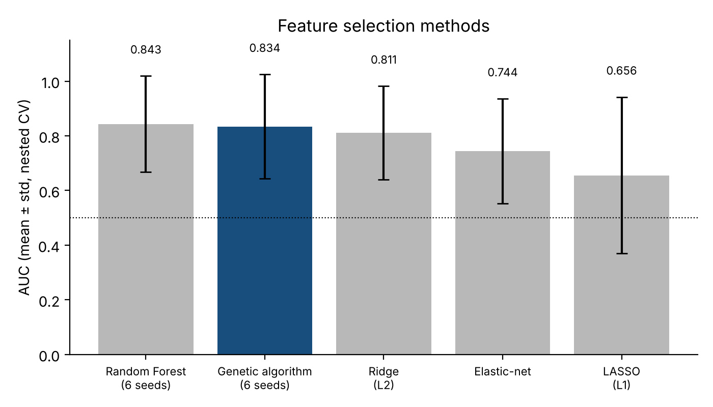
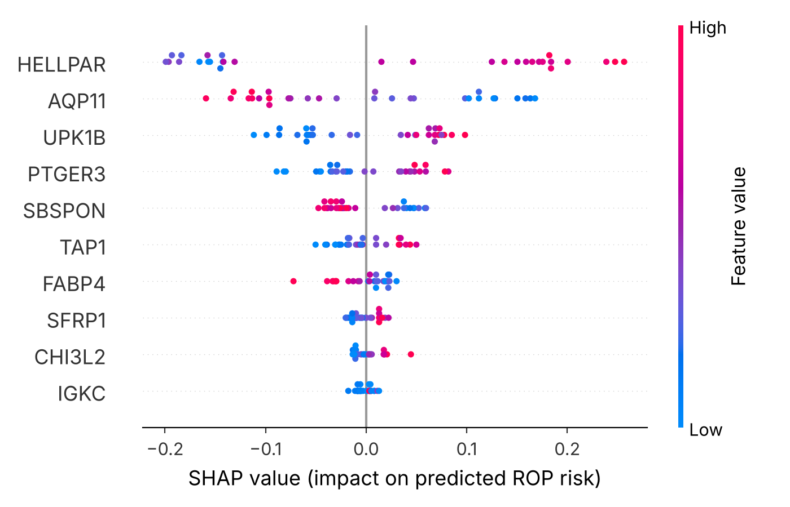

# Placental gene selection for ROP prediction

Code for my bachelor thesis at the Faculty of Computing (RAF), Belgrade:
*Development and Evaluation of a Genetic Algorithm for Placental Gene Selection in Predicting Retinopathy of Prematurity*
([English PDF](thesis/thesis_en.pdf), [Serbian PDF](thesis/thesis_sr.pdf)).

Retinopathy of prematurity (ROP) is a leading cause of childhood blindness in preterm infants. This project asks whether a
genetic algorithm can pick a small, predictive set of genes from placental RNA-seq, and how much that choice can be trusted
when the dataset has only 30 samples.

## Data

[GSE218039](https://www.ncbi.nlm.nih.gov/geo/query/acc.cgi?acc=GSE218039) (Owen et al., 2023): placental RNA-seq from
30 preterm infants, 14 with ROP and 16 without, 60,664 genes per sample. Both GEO files are included in `data/`.

## Approach

```
raw counts -> log2(CPM + 1) -> t-test DEG filter (124 candidates) -> genetic algorithm -> Random Forest
                                \________________ inside each outer fold of nested CV ________________/
```

- **Candidate pool:** genes with p < 0.05 and |log2FC| > 1 (121), plus 4 genes reported by Huang et al. (2026) on the same cohort.
- **Genetic algorithm:** binary chromosomes, tournament selection (k = 3), uniform crossover, bit-flip mutation (0.02), elitism,
  population 30, 30 generations. Fitness = cross-validated Random Forest AUC minus 0.001 per selected gene. Written from scratch in
  [`src/ga.py`](src/ga.py).
- **Evaluation:** 5-fold nested cross-validation. The DEG filter and the whole GA run only on the 24 training samples of each
  outer fold, so the 6 test samples never influence gene selection.
- **Interpretation:** SHAP on a final model trained on all samples, gene selection stability over 10 seeds, a permutation
  test, confounder checks and a patient similarity network.

## Results

| Method | AUC, nested CV | Genes used |
|---|---|---|
| Genetic algorithm (6 seeds x 5 folds) | 0.834 ± 0.191 | 4-19 |
| Random Forest, top-124 F-test genes (6 seeds x 5 folds) | 0.843 ± 0.176 | 124 |
| Ridge (L2) | 0.811 ± 0.171 | all candidates |
| Elastic-net | 0.744 ± 0.191 | 43-134 |
| LASSO (L1) | 0.656 ± 0.286 | 9-16 |



- The GA matches a Random Forest on 124 genes (0.834 vs 0.843, well inside the fold-to-fold spread) while using about
  8 genes on average, and beats elastic-net (0.744), the method used by Huang et al.
- With 6 test samples per fold, single runs are noisy. Across GA seeds the mean AUC ranges from 0.725 to 0.903, and fold 1 alone
  ranges from 0.125 to 0.875. The thesis reports one unseeded GA run (0.919 ± 0.068) against one RF run (0.878); this repository
  repeats both with six fixed seeds, which brings them level.
- Permutation test on the final gene set (500 shuffles of the labels): null AUC 0.48 ± 0.16. Compared with the nested estimate of 0.834, p = 0.012.

### Stable genes

Over 10 independent GA runs on all samples, only two genes are selected at least 5 times:

| Gene | Runs (of 10) | log2FC | Note |
|---|---|---|---|
| **HELLPAR** | 10 | +1.62 | placental lncRNA linked to HELLP syndrome (van Dijk et al., 2012) |
| **AQP11** | 7 | -1.00 | ER aquaporin, transports H2O2 (Bestetti et al., 2020) |

They are also the two strongest DEG genes and the only candidates that pass FDR correction (p_adj = 0.041).
Neither differs by sex or maternal preeclampsia. HELLPAR has the largest SHAP contribution in the final model.



These are hypotheses from one small cohort, not biomarkers. Gene identity is also sensitive to the DEG step: replacing the
t-test with DESeq2 gives similar AUC but different stable genes (see the thesis, Section 5.3).

## Repository

```
data/        GEO count matrix, sample metadata, gene symbols for the candidate pool
src/         data loading, DEG filter, genetic algorithm, nested validation
notebooks/   01 data and DEG, 02 nested CV, 03 final model and SHAP, 04 sensitivity and network
results/     cached results (JSON) and figures
tests/       fast checks, run on every push
thesis/      full thesis, English and Serbian
```

## Running

```bash
pip install -r requirements.txt
jupyter lab notebooks/
```

Heavy steps (GA runs, permutations) are cached in `results/*.json`, so the notebooks open with all outputs in seconds.
Delete a JSON file to recompute that step. A full recompute takes a few hours on a 2-core machine.

`pytest -q` (about 15 seconds) checks that the DEG pools match the thesis, that fold pools are built from training
samples only, and that the GA reports the gene names of the columns it actually selected.

## References

- Owen L. A. et al. (2023). Placental inflammation significantly correlates with reduced risk for retinopathy of prematurity. *Am J Pathol*, 193(11). Dataset GSE218039.
- Huang D. et al. (2026). Construction of a prediction model for retinopathy of prematurity based on placenta-derived genes and clinical variables. *Transl Pediatr*.
- van Dijk M. et al. (2012). HELLP babies link a novel lincRNA to the trophoblast cell cycle. *J Clin Invest*, 122(11).
- Bestetti S. et al. (2020). Human aquaporin-11 guarantees efficient transport of H2O2 across the ER membrane. *Redox Biology*, 28.

Full reference list in the thesis. Code is MIT-licensed.

Aleksandra Crnatović · [github.com/neoalexy](https://github.com/neoalexy)
